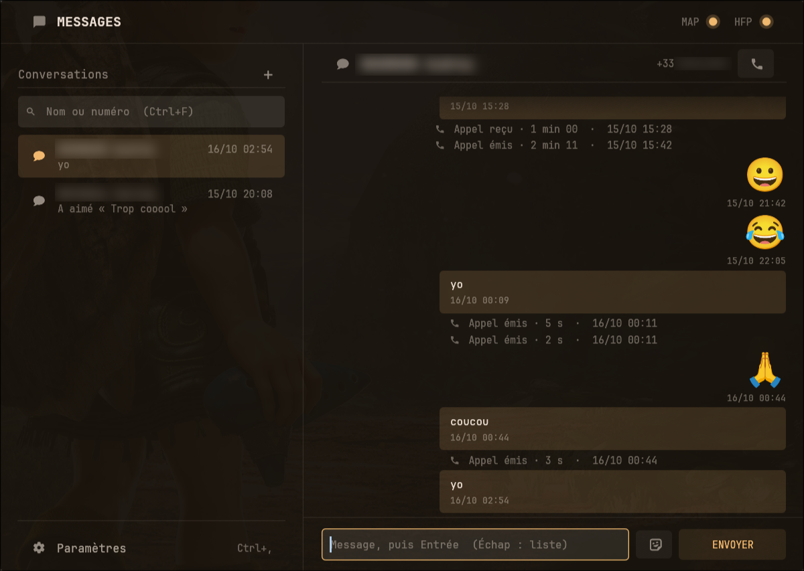
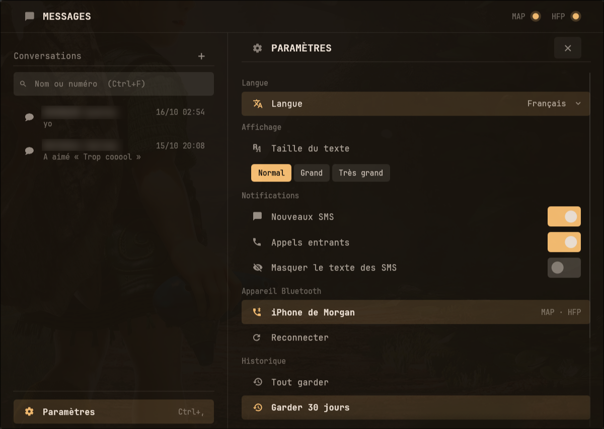

# bmessage (bluez-message)

[English](README.md) · **Français**

SMS et appels de l'iPhone sur un PC Linux, par Bluetooth uniquement : aucun serveur tiers, aucun compte
Apple, aucune app à installer sur le téléphone. Écrit en Rust, interface egui.

> **Projet « vibe codé »** : le code a été écrit par une IA ([Claude Code](https://claude.com/claude-code)),
> sous la direction de l'auteur, qui en a fixé les orientations de structure, d'optimisation et de
> sécurité, et l'a testé sur son propre matériel (iPhone 11, Arch Linux, Hyprland).

- **SMS** : lecture et envoi par le profil Bluetooth MAP (via `bluez-obex`).
- **Contacts** : synchronisés par PBAP toutes les 6 h (noms dans les conversations, recherche).
- **Appels** : sonnerie, décrocher, refuser, raccrocher, muet, attente, double appel, appel sortant.
  L'audio (mSBC) passe par PipeWire/WirePlumber en rôle HFP mains libres.
- **Notifications** de bureau (SMS, appel entrant avec boutons Décrocher / Refuser), même fenêtre fermée.
- **Historique local** SQLite, suppression locale, réactions, interface traduisible (anglais, français).




> Limites connues : iOS n'expose pas les iMessage par MAP (seulement les SMS/MMS texte) ; les dossiers
> MAP `sent`/`outbox` sont vides côté iPhone, les envois de l'app sont donc consignés localement ; les
> réactions (tapbacks) sont envoyées sous forme de SMS texte (« Liked “…” »).

## Composants

| Binaire | Rôle |
|---|---|
| `bluez-messaged` | Démon (service systemd utilisateur) : MAP, PBAP, appels, notifications, historique, socket pour les clients. |
| `bluez-message` | Fenêtre principale (menu : **bmessage**), client du démon. |
| `bluez-msg-call` | Petite fenêtre de l'appel en cours, lancée par le démon au décroché. |
| `bluez-msg` | Outil en ligne de commande (tests MAP/HFP, fichiers de traduction). |

## Prérequis

- Linux avec BlueZ, `bluez-obex`, PipeWire et WirePlumber (≥ 0.5, service `org.pipewire.Telephony`).
- Un serveur de notifications (mako, dunst, swaync…) pour les notifications.
- Vulkan conseillé (rendu plus léger), sinon repli OpenGL.
- Police conseillée : JetBrainsMono Nerd Font (icônes), Noto Color Emoji.
- Pour compiler : Rust ≥ 1.91 (édition 2024).

## Installation

### Arch Linux

Paquet précompilé (x86_64), depuis les [releases](https://github.com/morganorix/bluez-message/releases),
signé par la clé `E12F0EA82A218B98A786F25C6BF70F0B266A6EB9`. Une seule fois, approuver la clé :

```sh
curl -sL https://github.com/morganorix/bluez-message/releases/download/v0.1.4/morganorix.asc | sudo pacman-key --add -
sudo pacman-key --lsign-key E12F0EA82A218B98A786F25C6BF70F0B266A6EB9
```

Puis installer :

```sh
sudo pacman -U https://github.com/morganorix/bluez-message/releases/download/v0.1.4/bluez-message-0.1.4-1-x86_64.pkg.tar.zst
```

Ou compilé depuis une copie du dépôt :

```sh
cd packaging/arch
makepkg -si
```

Le paquet installe les quatre binaires, le service `bluez-messaged` (activé pour toutes les sessions
utilisateur), l'entrée de menu **bmessage**, l'icône et la configuration WirePlumber. Détails :
[`packaging/arch/README.md`](packaging/arch/README.md).

### Autres distributions (manuel)

```sh
cargo build --release --all-features
install -Dm755 -t ~/.local/bin target/release/{bluez-msg,bluez-messaged,bluez-message,bluez-msg-call}

# Service utilisateur (adapter ExecStart à ~/.local/bin/bluez-messaged)
install -Dm644 packaging/arch/bluez-messaged.service ~/.config/systemd/user/bluez-messaged.service
sed -i "s#/usr/bin/#$HOME/.local/bin/#" ~/.config/systemd/user/bluez-messaged.service

# Entrée de menu et icône
install -Dm644 packaging/arch/bluez-message.desktop ~/.local/share/applications/bluez-message.desktop
install -Dm644 packaging/arch/bluez-message.svg ~/.local/share/icons/hicolor/scalable/apps/bluez-message.svg

# Audio des appels (rôle HFP mains libres + gain du son reçu)
install -Dm644 -t ~/.config/wireplumber/wireplumber.conf.d packaging/arch/5{2,3}-*.conf
install -Dm644 -t ~/.local/share/wireplumber/scripts packaging/arch/bluez-message-call-gain.lua

systemctl --user daemon-reload
systemctl --user restart wireplumber
systemctl --user enable --now bluez-messaged
```

Après un redémarrage de WirePlumber, reconnecter l'iPhone (`bluetoothctl disconnect` puis `connect`).

## Mise en route

1. Appairer l'iPhone une seule fois :
   ```sh
   bluetoothctl
   # power on, scan on, pair <adresse>, trust <adresse>, connect <adresse>
   ```
2. Sur l'iPhone, dans Réglages > Bluetooth > (i) du PC : activer **Afficher les notifications** (MAP)
   et **Synchroniser les contacts** (PBAP). iOS demande aussi l'autorisation au premier accès.
3. Ouvrir **bmessage** depuis le menu, puis **Paramètres > Appareil Bluetooth** : choisir l'iPhone.
   (Équivalent manuel : écrire l'adresse `AA:BB:CC:DD:EE:FF` dans `~/.config/bluez-message/device`, puis
   `systemctl --user restart bluez-messaged`.)

## Utilisation

### Fenêtre principale

- Colonne de gauche : conversations, champ de recherche « Nom ou numéro » (accents ignorés, `06…` ou
  `+33…` ; Entrée ouvre le premier résultat).
- Fil de discussion : envoi, bouton emojis, bouton d'appel dans l'en-tête.
- Clic droit sur une bulle : réaction, Renvoyer, Copier, Supprimer (suppression locale seulement, jamais
  sur l'iPhone).
- Un envoi en attente affiche une barre de progression ; en échec, un bouton permet de le renvoyer.

Raccourcis : `↑`/`↓` + `Entrée` dans la liste, `Échap`, `Ctrl+F` (recherche), `Ctrl+,` (paramètres).

### Appels

À la sonnerie, une notification propose **Décrocher** / **Refuser**. Une fois l'appel établi, la fenêtre
`bluez-msg-call` affiche la durée et les boutons Muet, Attente, Raccrocher (et Répondre / Refuser /
Basculer en double appel). Elle se ferme seule en fin d'appel.

### Paramètres

Langue (à chaud), notifications SMS / appels / masquage du texte, appareil Bluetooth, Reconnecter,
durée de conservation (30 / 90 / 365 jours), purge des messages supprimés, Tout effacer (double
confirmation, les contacts sont gardés).

### Ligne de commande

```sh
bluez-msg list <adresse> [inbox|sent|outbox|deleted]   # JSON, un message par ligne
bluez-msg send <adresse> <numéro> "<texte>"
bluez-msg watch <adresse> [--interval 5]
bluez-msg serve <adresse>                              # moteur piloté en JSON par stdin/stdout
bluez-msg hfp <adresse> [--answer]                     # HFP RFCOMM brut, sans audio (hfp_hf désactivé)
bluez-msg locale template | check <fichier>
```

## Fichiers

| Chemin | Contenu |
|---|---|
| `~/.config/bluez-message/device` | Adresse Bluetooth de l'iPhone (0600). |
| `~/.config/bluez-message/settings.json` | Réglages (écrits par le démon seul). |
| `~/.config/bluez-message/locales/<lang>.json` | Traductions personnelles. |
| `~/.local/share/bluez-message/history.db` | Historique SQLite (SMS, appels, contacts, lectures). |
| `$XDG_RUNTIME_DIR/bluez-message.sock` | Socket du démon (JSON lignes). |
| `~/.config/control-bar/colors.plm` | Optionnel : palette de couleurs (template matugen), rechargée à chaud. |

Variable `BLUEZ_MESSAGE_LANG` : force la langue (`fr`, `en`…).
Variable `BLUEZ_MESSAGE_LOG` : niveau du journal (`info` par défaut, sans numéros, noms, textes ni
adresses ; `debug` pour un diagnostic, par ex. `systemctl --user edit bluez-messaged` →
`Environment=BLUEZ_MESSAGE_LOG=debug`).

### Hyprland (optionnel)

Classes de fenêtre : `bluez-message` (principale ; conseillé : flottante, centrée, 900×640) et
`bluez-msg-call` (appel ; conseillé : flottante, épinglée, 420×150, en haut de l'écran).

## Traductions

Les textes sont écrits en anglais dans le code et traduits à l'exécution depuis des fichiers JSON.
Ajouter une langue : voir [`locales/README.md`](locales/README.md).

## Architecture du code

```
src/
├── main.rs              CLI bluez-msg
├── bin/
│   ├── bluez-messaged.rs        démon : moteur, notifications, historique, socket, surveillance du lien
│   ├── bluez-message/           fenêtre principale (ui, convs, thread, composer, prefs)
│   └── bluez-msg-call/          fenêtre d'appel
├── engine.rs            moteur commun : polling MAP, envoi, appels (commandes Cmd / sorties Out)
├── map.rs, obex.rs      client MAP sur bluez-obex (D-Bus)
├── bmsg.rs              encodage/décodage bMessage (SMS)
├── pbap.rs              contacts (vCard)
├── telephony.rs         client D-Bus org.pipewire.Telephony (appels, audio HFP tenu par PipeWire)
├── hfp.rs               unité mains libres RFCOMM brute (commandes AT, CLI seulement)
├── bluez.rs             état et reconnexion de l'appareil (org.bluez)
├── ipc.rs               protocole JSON lignes démon ↔ clients
├── history.rs           base SQLite (migrations user_version)
├── settings.rs, config.rs, i18n.rs, phone.rs, stamp.rs, addr.rs, error.rs
├── app/                 état partagé (conversations, appel), notifications, réactions
└── gui/                 thème, widgets, emojis, démarrage egui
locales/                 fr.json (embarqué), template.json, README
packaging/arch/          PKGBUILD, service systemd, .desktop, icône, config WirePlumber
```

## Développement

```sh
cargo build --all-features
cargo test --all-features
cargo clippy --all-features --all-targets -- -D warnings
```

Toute nouvelle chaîne `t!("…")` doit être ajoutée à `locales/template.json` (vérifié par le test
`template_matches_sources`).

## Licence

[MIT](LICENSE)
